<p align="center">
  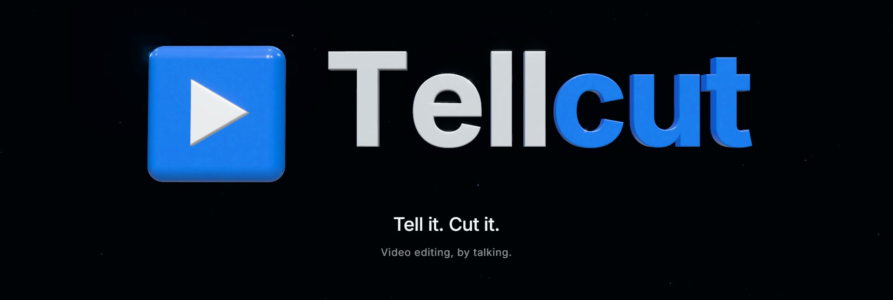
</p>

<p align="center"><strong>話しかけるだけで、動画編集。</strong></p>

<p align="center">素材を入れて、作りたい動画をひとこと伝えるだけ。エージェントがすべてのクリップを見て、<br>絵コンテを書き、最初の編集まで仕上げます。すべてあなたのパソコンの中で。<br>気に入ったエフェクトやスタイルは残しておけて、次の 1 本はそこから始まります。</p>

<p align="center">
  <a href="README.md">English</a> &nbsp;·&nbsp; <a href="README.zh-TW.md">繁體中文</a> &nbsp;·&nbsp; <strong>日本語</strong>
</p>

<p align="center">
  <a href="#動画を見る">動画を見る</a> &nbsp;·&nbsp;
  <a href="#3通りの編集">3 通りの編集</a> &nbsp;·&nbsp;
  <a href="#エージェントがすること">エージェントがすること</a> &nbsp;·&nbsp;
  <a href="#作るほど次が楽になる">良かったものを残す</a> &nbsp;·&nbsp;
  <a href="#プリセット">プリセットとサンプル</a> &nbsp;·&nbsp;
  <a href="#はじめる">はじめる</a> &nbsp;·&nbsp;
  <a href="#外部の素材ソース">外部の素材</a> &nbsp;·&nbsp;
  <a href="INSTALL.md">インストールガイド（英語）</a>
</p>

<p align="center">
  
  
  
  
  <a href="LICENSE"></a>
</p>

---

## 動画を見る

<div align="center">
  <video src="https://github.com/user-attachments/assets/26bcd705-6045-4594-aca9-aaf5642b691c" width="100%" controls></video>
</div>

> **「30 秒でわかる Tellcut」**：マラケシュで撮った 19 分の素材とひとことの指示が、コミック風のリールになります。エージェントは編集を始める前にすべてのクリップを見て、使うショットを選びます。一部分を選んで修正を頼むと、何かが変わる前にまずプレビューが出ます。この動画の作り方をマイプリセットとして保存すれば、次の旅（ここではローマ）もクリック 1 回とひとことで同じスタイルに仕上がります。Tellcut で収録し、エージェントが作業している部分は早送りしています。（[クレジット](docs/readme/CREDITS.md)）

---

## 3通りの編集

いつでも行き来できます。自分で直したところを、エージェントが上書きすることはありません。

<table>
  <tr>
    <td width="38%" valign="top">
      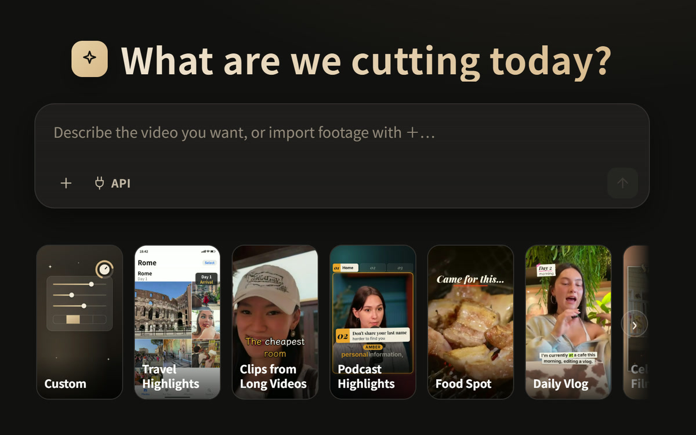
    </td>
    <td valign="top">
      <h3>1. 話しかける</h3>
      素材を読み込んで、作りたいものを伝えます。切り口、ショット、字幕、エフェクト、音楽はエージェントが決めて、すぐに見られる最初の編集を仕上げます。
      <br><br>
      何と言えばいいかわからなければ、入力欄の下の<a href="#プリセット">プリセット</a>を選ぶと、その種類の動画の作り方が入ります。
    </td>
  </tr>
</table>

<p align="center">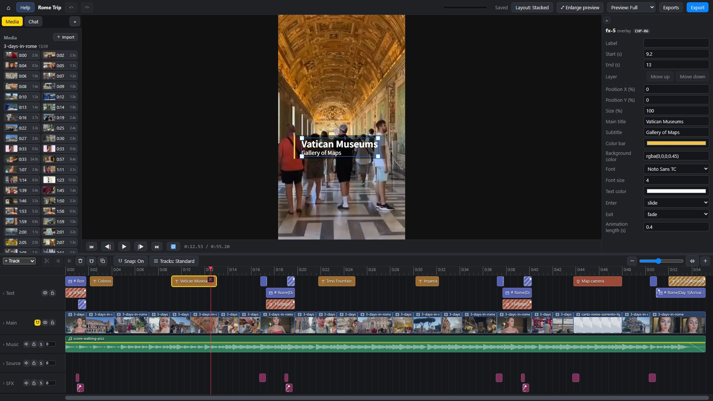</p>

**2. タイムラインで直す。** 普通の編集ソフトと同じように使えます。クリップの分割、メディアパネルの別のショットへの差し替え（**Import** でパソコンから素材を追加することもできます）、音量の調整、字幕の修正。どの操作も元に戻せます。

**3. 修正を頼む。** チャットに書くか、タイムラインの一部を選んで右クリックし、**Ask Agent…** でその部分をどうしたいか伝えます。エージェントはまずプレビューを見せ、**Accept** を押すまで何も変わりません。

---

## エージェントがすること

<table>
  <tr>
    <td width="50%" valign="top">
      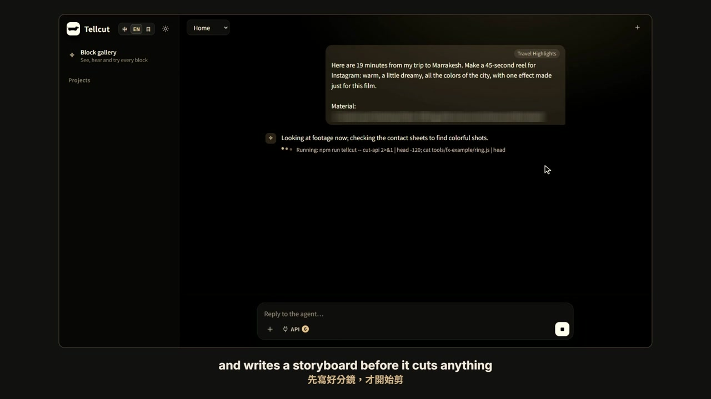<br>
      <strong>すべてのクリップを見る。</strong><br>
      素材をシーンに分け、コンタクトシートを作り、話している内容を文字に起こし、元の映像に焼き込まれた字幕や透かしも見つけます。
    </td>
    <td width="50%" valign="top">
      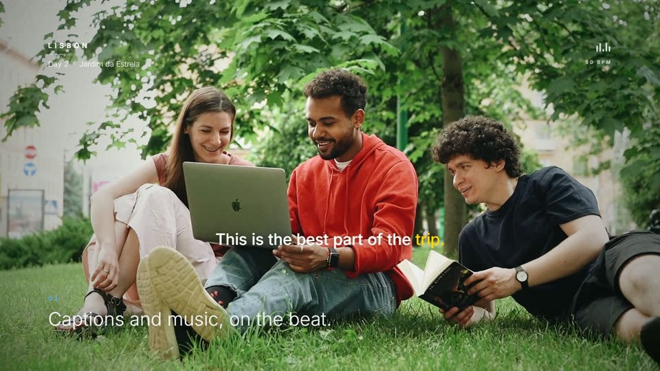<br>
      <strong>字幕と音楽をビートに合わせて。</strong><br>
      160 種類以上の既製のエフェクトと効果音、約 140 種類の字幕とタイトルのスタイルを持っていて、BGM は長さに合わせて作曲します。動画の言語でナレーションを付け、字幕をそれに合わせることもできます。ライブラリに合うものがなければ、その動画専用のエフェクトを書き、それを次の動画のために<a href="#作るほど次が楽になる">残しておく</a>こともできます。
    </td>
  </tr>
  <tr>
    <td valign="top">
      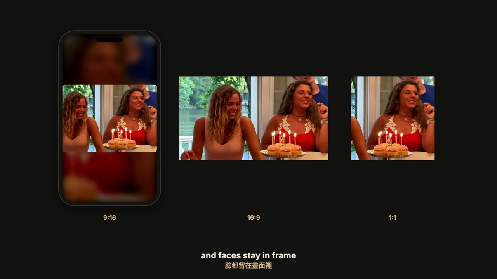<br>
      <strong>縦型。横型。正方形。</strong><br>
      9:16、16:9、1:1、4:5 の MP4 で書き出します。縦型に切り出すときは、顔がフレームから外れないようにします。
    </td>
    <td valign="top">
      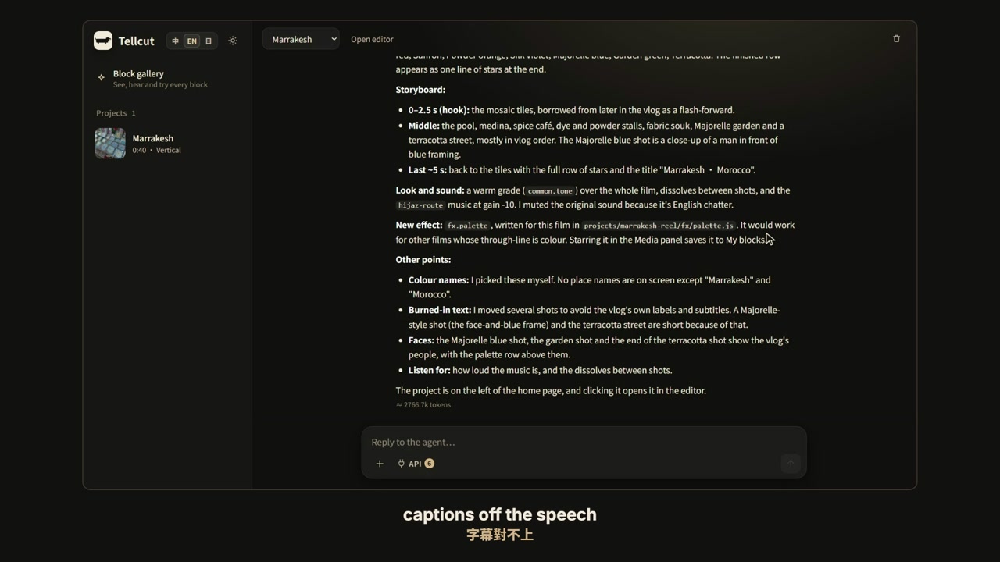<br>
      <strong>自分の仕事をチェックする。</strong><br>
      あなたが見る前に、黒いフレーム、話とずれた字幕、画面からはみ出た文字、音割れ、元の映像の文字の映り込みがないか調べ、見つけたものを先に直します。
    </td>
  </tr>
</table>

編集を始める前に、まずどんな動画か（グルメ、旅行、レッスン、インタビュー…）を見極めて、その種類の動画に必要な絵コンテを書きます。

## 作るほど次が楽になる

<p align="center"><strong>うまくいったものを残す。次の 1 本はそこから。</strong></p>

たいていの編集ソフトは、プロジェクトを閉じた瞬間にすべてを忘れます。Tellcut は気に入ったものを残しておきます。

<table>
  <tr>
    <td width="50%" valign="top">
      <h3>★ エフェクトを残す</h3>
      カフェの動画のために黒板風のタイトルを、メニューを印字するレシートを、ルートを描く地図を、エージェントが書いてくれたとします。横の <strong>☆</strong> を押すと<strong>マイブロック</strong>に入ります。
      <br><br>
      それからはどのプロジェクトのメディアパネルにも出てきて、エージェントも新しく書く前にまずそれを使います。どんな文字や色でも使えるようにしたいなら、<strong>エージェントに汎用化してもらう</strong>にチェックを入れると、固定で書かれていた部分が変更できる設定になります。
    </td>
    <td width="50%" valign="top">
      <h3>⟳ スタイルを残す</h3>
      気に入ったリズムが見つかったら <strong>Save as preset</strong> を押します。エージェントがこの動画の作り方を、わかりやすい言葉で一つずつ書き出します。「2 秒以内にいちばん良いショットで始める」「字幕は真ん中の少し下」「値段のカードは出さない」。いらないものは消し、自分の項目を足すと、フォント、色、音楽、エフェクトごと、ホーム画面のカードになります。
      <br><br>
      次の旅では、クリック 1 回で最初の編集からもうあなたらしい仕上がりです。
    </td>
  </tr>
</table>

- **見えているものが、エージェントに渡るすべて。** プリセットの項目がそのまま指示のすべてです。項目を消せば、その指示はなくなります。
- **過去の動画が知らないうちに変わることはありません。** ブロックは使うプロジェクトごとにコピーされます。あとで改良すると、ほかのプロジェクトには **Update** が表示され、押したときだけ切り替わります。
- **動画がなくても作れます。** **カスタム**フォームで項目を選んで**マイプリセットとして保存**を押すか、ホーム画面のプリセットの最後にある**新しいプリセット**を押して、項目を自分で書きます。
- ブロックギャラリーの**マイブロック**カテゴリで一覧・名前の変更・お試しができ、エージェントに変更を頼むこともできます。

---

## プリセット

プリセットは、ある種類の動画のための出発点です。入力欄の下のカードをクリックして内容を読み、**確定**を押します。プリセットを使わずに、作りたいものをそのまま伝えてもかまいません。

下のアニメーションは、それぞれのプリセットで作ったサンプル動画です。クリックすると、元の素材と手を加えた内容がわかります。実写のサンプルは YouTube で [CC BY 3.0](https://creativecommons.org/licenses/by/3.0/) のもと公開された動画を改変したもので、字幕、タイトル、カード、音楽は Tellcut が付けました。ブランドムービーと図解ムービーのサンプルは素材を一切使わず、画面のすべてをエージェントが描いています。

<table>
  <tr>
    <td align="center" valign="top" width="33%">
      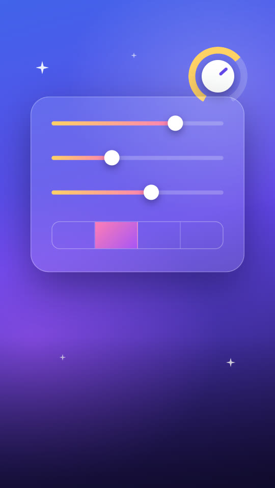<br>
      <strong>カスタム</strong><br>
      比率、長さ、フレーミングなどはあなたが決め、残りはエージェントが決めます。選んだ内容はマイプリセットとして保存できます
    </td>
    <td align="center" valign="top" width="33%">
      <a href="guides/presets/travel/CREDITS.md"></a><br>
      <strong>旅のハイライト</strong><br>
      旅先で撮りためたクリップを、IG や Shorts 向けの縦型ショートに<br>
      <sub>サンプル：55 秒 · ローマの 3 日間 · 素材 Jackie Vlogs</sub>
    </td>
    <td align="center" valign="top" width="33%">
      <a href="guides/presets/clips/CREDITS.md"></a><br>
      <strong>切り抜き</strong><br>
      完成した長尺動画のいちばんの見どころを。本編へ誘導したいならフックも付けます<br>
      <sub>サンプル：37 秒 · マラケシュ Vlog の 1 場面 · 素材 Helen</sub>
    </td>
  </tr>
  <tr>
    <td align="center" valign="top">
      <a href="guides/presets/podcast/CREDITS.md">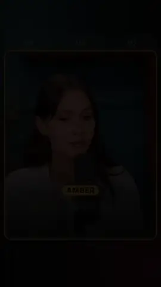</a><br>
      <strong>ポッドキャスト切り抜き</strong><br>
      ポッドキャストやインタビューのいちばんのやりとりを。話している人をはっきり示し、字幕は単語ごとに<br>
      <sub>サンプル：58 秒 · 話者 2 人 · 素材 Lila Rose</sub>
    </td>
    <td align="center" valign="top">
      <a href="guides/presets/food/CREDITS.md"></a><br>
      <strong>グルメ紹介</strong><br>
      お店や食べ歩きを、お腹が空いてくるショートに<br>
      <sub>サンプル：58 秒 · ソウルの焼肉とベーカリー · 素材 千千進食中</sub>
    </td>
    <td align="center" valign="top">
      <a href="guides/presets/vlog/CREDITS.md">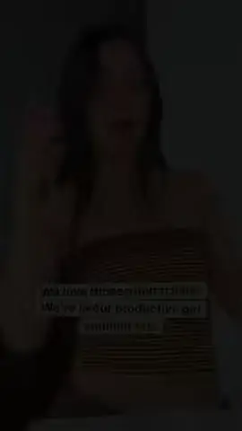</a><br>
      <strong>日常 Vlog</strong><br>
      ある 1 日や日々の暮らしを、リズムと起承転結のある 1 本に<br>
      <sub>サンプル：66 秒 · 3 日間と 1 枚の To Do リスト · 素材 Michaela Bento</sub>
    </td>
  </tr>
  <tr>
    <td align="center" valign="top">
      <a href="guides/presets/celebration/CREDITS.md">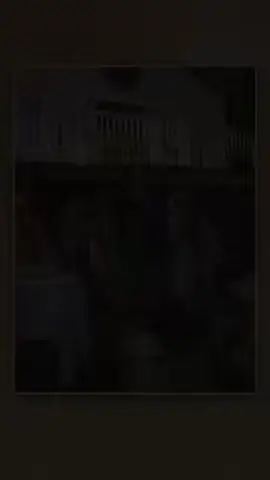</a><br>
      <strong>記念ムービー</strong><br>
      結婚式、誕生日、卒業、送別の写真やクリップを、当日に流す 1 本に<br>
      <sub>サンプル：88 秒 · サプライズの 16 歳の誕生日 · 素材 It's The Donnellys</sub>
    </td>
    <td align="center" valign="top">
      <a href="guides/presets/brand/CREDITS.md"></a><br>
      <strong>ブランドムービー</strong><br>
      ロゴ、会社の紹介文、ウェブサイトから、ひと目でその会社らしいとわかるブランドムービーを。自前の映像や写真があればさらに良くなります<br>
      <sub>サンプル：57 秒、横型 · Tellcut 自身のブランドムービー · ロゴだけから描画</sub>
    </td>
    <td align="center" valign="top">
      <a href="guides/presets/explainer/CREDITS.md">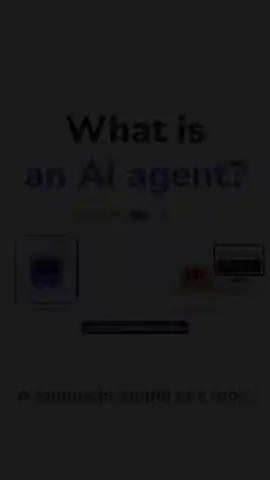</a><br>
      <strong>図解ムービー</strong><br>
      ひとつのテーマを、図、グラフ、クイズ、よくある誤解の検証で説明します。自前の素材はあってもなくても<br>
      <sub>サンプル：2 分 9 秒、横型 · AI エージェントとは？ · 素材なし</sub>
    </td>
  </tr>
</table>

**マイプリセット**はこれらのあとに「**マイ**」の印付きで並びます。気に入った動画から保存する（編集画面のチャットの **Save as preset**）か、**カスタム**フォームから保存します。[作るほど次が楽になる](#作るほど次が楽になる)を見てください。

---

## はじめる

**必要なもの**

- **Windows 10 または 11**（64 ビット）、または **macOS 14 以降**（Apple シリコン。macOS 26 で動作確認）
- **Claude アカウント**：Pro、Max、Team、Enterprise プラン、または Claude API アカウント。編集するエージェントは Claude Code で、あなた自身のアカウントで動きます（[使用量と料金](#使用量と料金)を参照）
- 約 **4 GB** の空き容量とインターネット接続（最初のインストールで約 2 GB をダウンロードします）

Node.js、Google Chrome、Python、ffmpeg などは、下のどちらの方法でも自動で用意されます。

### 方法 1：Claude Code にインストールしてもらう（おすすめ）

Claude Code はターミナルで動く Claude です。あなたのパソコンでダウンロード、インストール、コマンドの実行ができ、エラーが出ればその場で直してくれます。ウェブ版の Claude（claude.ai）はあなたのパソコンに触れられないので、手順を教えることしかできません。

1. **ターミナルを開く**：
   - **Windows**：PowerShell を開きます。スタートキーを押して `PowerShell` と入力し、Enter。管理者として実行する必要はありません。
   - **Mac**：⌘ Space を押して `ターミナル`（または `Terminal`）と入力し、Enter。[Homebrew](https://brew.sh) がまだなければ、この 1 行でインストールします（Mac のパスワードを聞かれます。入力しても画面には表示されません）：

     ```bash
     /bin/bash -c "$(curl -fsSL https://raw.githubusercontent.com/Homebrew/install/HEAD/install.sh)"
     ```
2. **Claude Code をインストール**：この 1 行を貼り付けて Enter。

   Windows：

   ```powershell
   irm https://claude.ai/install.ps1 | iex
   ```

   Mac：

   ```bash
   curl -fsSL https://claude.ai/install.sh | bash
   ```

   続けて `claude --version` と入力し、バージョン番号が出ればインストール完了です。`claude` が見つからないと言われたら、ウィンドウを閉じて開き直してください。Windows では `winget install Anthropic.ClaudeCode` でも入れられます（[公式のセットアップガイド](https://code.claude.com/docs/en/setup)）。
3. **サインイン**：`claude` と入力して Enter を押し、開いたブラウザで Claude アカウントにサインインします。
4. **Opus 5.5 を選ぶ**：Claude Code で `/model opus` と入力して Enter。おすすめは Opus 5.5 で、Tellcut のインストールも編集もこのモデルで確認しています。Opus 5.5 には Claude Code 2.1.280 以降が必要です。古い場合は先にターミナルで `claude update` を実行してください。
5. **これを貼り付けて送る**（Windows でも Mac でも同じ文章です）：

   ```text
   Tellcut をインストールしてください：https://github.com/samuel325365/Tellcut
   リポジトリの INSTALL.md のとおりに進めてください。Node.js 24 以降か Google Chrome がなければ、先に winget で入れてください。
   Mac の場合は「On a Mac」の節に従ってください。brew が見つからなければ Homebrew を PATH に追加し、Homebrew で node@24（~/.zshrc で PATH に追加）、Google Chrome、ffmpeg-full を入れてください。Xcode のコマンドラインツールがなければ xcode-select --install を実行してください（開いたウィンドウの操作が終わるまで待ってください）。
   リポジトリはユーザーフォルダの中の Tellcut フォルダにダウンロードし、npm run setup を実行して、最後に npm run doctor ですべての項目にチェックが付くことを確認してください。
   何か失敗したら直して続けてください。すべて終わったら、これから Tellcut をどうやって開けばいいか教えてください。
   ```

   Claude Code は何かするたびに先に確認してきます。内容を見てから許可してください。全体で 15〜30 分ほどかかり、ほとんどはダウンロードの時間です。
6. **Tellcut を開く**：これからは使うたびに、ターミナル（PowerShell、Mac ではターミナル）でこれを実行します：

   ```
   cd ~/Tellcut
   npm run server
   ```

   それからブラウザで <http://127.0.0.1:5174/editor/> を開きます。作業中はターミナルのウィンドウを開いたままにしてください。閉じると Tellcut も止まります。

**Codex などほかの AI コーディングアシスタントでもインストールできます**：手順 5 の文章を渡してください。ただし Tellcut の中のエージェントは常に Claude Code なので、手順 2〜3 は必要です。

### 方法 2：自分でインストールする

1. [Node.js](https://nodejs.org/) 24 以降（LTS）、[Google Chrome](https://www.google.com/chrome/)、[Claude Code](https://code.claude.com/docs/en/setup) をインストールし、ターミナルで一度 `claude` を実行してサインインします。Mac では [INSTALL.md › On a Mac](INSTALL.md#on-a-mac) のとおり、Homebrew の `node@24` と `ffmpeg-full`、Xcode のコマンドラインツールを入れてください。
2. Tellcut を入手します。Git があれば（[Windows 版](https://git-scm.com/downloads/win)。Mac は Xcode のコマンドラインツールに含まれます）`git clone https://github.com/samuel325365/Tellcut.git` を実行します。なければ GitHub の緑の **Code** ボタン → **Download ZIP** でダウンロードして展開します。あとで更新するときは git のほうが楽です。
3. Tellcut フォルダでターミナルを開きます（Windows ではフォルダの何もないところを右クリック → **ターミナルで開く**、Mac ではターミナルで `cd` してフォルダへ）。最初に一度だけこれを実行します。Tellcut に必要なツールとモデルをダウンロードします（10〜20 分）：

   ```
   npm run setup
   ```

   それからは使うたびにこれを実行し、ブラウザで <http://127.0.0.1:5174/editor/> を開きます：

   ```
   npm run server
   ```

トラブルシューティングを含む詳しい手順は **[INSTALL.md](INSTALL.md)**（英語）にあります。うまく動かないときは `npm run doctor` で足りないものと直し方がわかります。Claude Code に「Tellcut が開かないので見てもらえますか」と頼むだけでもかまいません。

**更新するには**：git を使った場合は Tellcut フォルダで `git pull` を実行し、もう一度 `npm run setup` を実行します。

### モデルについて

Tellcut のエージェントは Claude Code の**デフォルトのモデル**を使います。Pro、Max、Team、Enterprise、Claude API のアカウントでは現在 **Opus 5.5** で、これがおすすめのモデルなので、設定は何も要りません。ページのチャットはあなた個人の Claude Code の設定を読まないので、ターミナルで `/model` を切り替えても Tellcut が使うモデルは変わりません。

### 最初の 1 本

ホーム画面の右側のチャットで **＋** を押して素材を読み込み、作りたい動画をエージェントに伝えます。何と言えばいいか迷ったら[話しかけ方の例](#話しかけ方の例)を見るか、[プリセット](#プリセット)を選んでください。

画面は English、中文、日本語に対応しています。ホーム画面の右上の **中 / EN / 日** で切り替えます。編集画面のボタン名は常に英語で、ツールチップとヘルプは選んだ言語で表示されます。

> 素材と完成した動画はあなたのパソコンから出ません。エージェントとチャットするときは、あなたのメッセージと、エージェントが見る必要のあるフレームが Anthropic に送られます。

---

## サンプルプロジェクト

*Meet Tellcut* は、クリエイティブ・コモンズの素材で作った Tellcut 紹介動画で（上のロゴだけのブランドムービーとは別物です）、開いて、再生して、手を加えられるプロジェクトとして用意しています。素材、エージェントとのチャットとバージョン履歴、完成した動画が入っています。ブランドムービーのプリセットで作りました。ダウンロードして（約 900 MB）プロジェクトに追加するには、これを実行します：

```
npm run examples -- meet-tellcut
```

素材の出典は中の `CREDITS.md` にあり、すべてクリエイティブ・コモンズ（CC BY 3.0）です。

---

## 外部の素材ソース

自分の素材のほかに、エージェントはオンラインのライブラリやデータベースから写真、動画、効果音、音楽、地図を探せます。ほとんどは登録なしで使えます。いくつかは自分で取得する無料のキーが必要で、キーがなければそのソースが使えないだけで、ほかはすべて今までどおり動きます。

> これらのキーは Claude とは関係ありません。エージェントは Claude Code でサインインしたアカウントで動くので、別途 Claude API キーを用意する必要はありません。ナレーション（Microsoft Edge のオンライン音声）、文字起こし（あなたのパソコンで動く Whisper）、音楽（動画の長さに合わせて作曲）も組み込みで、キーは要りません。ナレーションに ElevenLabs の声を使いたい場合は、下の [ElevenLabs のナレーション](#elevenlabs-のナレーション)を見てください（こちらは別にキーが必要です）。

Tellcut はダウンロードしたファイルごとに出典とライセンスをプロジェクトに記録し、`npm run tellcut -- assets credits <project>` でプロジェクトフォルダの `media/CREDITS.md` にまとめます。**公開や商用利用の前に、ライセンスの列を確認してください**。ポケモン、アニメ、ゲーム、ハリー・ポッターの画像は、それぞれの権利者のものです。

**登録不要ですぐ使える**

| ソース | 得られるもの | ライセンス |
|---|---|---|
| **Wikimedia Commons** | 写真、イラスト、歴史的な画像 | ファイルごとに異なり、多くは CC BY、CC BY-SA、パブリックドメイン |
| **NASA Image and Video Library** | 宇宙と地球の写真と動画 | 原則として著作権なし。NASA が推奨しているように見せてはいけません |
| **地図** | 台湾の国土電子地図と正射写真、EOX の衛星画像。ルートのアニメーションや地図のシーンに | 台湾の地図：政府オープンデータライセンス（商用可、出典表示が必要）。EOX の衛星画像：CC BY-NC-SA 4.0（非商用） |
| **国の情報** | 国旗と、首都、人口、言語、通貨などのデータ | 国旗はパブリックドメイン |
| **TheMealDB**、**TheCocktailDB** | 料理とカクテルの写真とレシピ | 公開テストキーを使用：個人利用と開発用のみ |
| **PokeAPI** | ポケモンの画像と図鑑データ | © Nintendo / Creatures / GAME FREAK |
| **AniList** | アニメ・マンガのキャラクター画像と表紙 | © 各作品の権利者 |
| **AmiiboAPI** | amiibo フィギュアの画像 | © Nintendo |
| **ゲーム Wiki** | スーパーマリオとゼルダの Wiki のゲーム画像 | © 各ゲーム会社（Wiki がフェアユースとして掲載） |
| **HP-API + PotterDB** | ハリー・ポッターのキャラクター、呪文、画像 | © Warner Bros. |

**無料のキーが必要**

| ソース | 得られるもの | ライセンス | キーの取得先 |
|---|---|---|---|
| **Pixabay** | ストック動画と写真 | Pixabay Content License（商用可、出典表示不要） | Pixabay に登録すると、<https://pixabay.com/api/docs/> にキーが表示されます |
| **Freesound** | 効果音 | 音ごとに異なる：CC0、CC BY、CC BY-NC… | Freesound にサインインして <https://freesound.org/apiv2/apply> で申請し、表示される「Client secret/Api key」を使います |
| **CARTO** | 地図シーン用の道路地図ベースマップ | 非商用のみ | <https://carto.com/basemaps> でメールアドレスを入れて申請（アカウント不要） |

**初期状態はオフ、自分でオンにする**（非公式、または個人利用のみ）

| ソース | 得られるもの | ライセンス |
|---|---|---|
| **BBC Sound Effects** | BBC のプロの効果音 約 33,000 種 | RemArc：個人・教育・研究目的のみ、再配布不可 |
| **Incompetech** | Kevin MacLeod の音楽（archive.org のコピーからダウンロード） | CC BY 4.0（商用可、出典表示が必要） |
| **Steam** | ゲームのストアのカバー、スクリーンショット、トレーラー（非公式 API） | © 各ゲームの開発元・販売元 |

### キーの登録とソースの切り替え

いちばん手軽なのは、チャット欄の **API** メニューで **キーなし** と表示されたソースをクリックし、キーを貼り付けて保存する方法です。Tellcut はキーを一度試してから、`tellcut` フォルダの `sources.local.json` に保存します。このファイルは Git に無視されるので、コミットされることはありません。

ファイルを自分で書くこともできます（連絡先もここに書きます）：

```json
{
  "contact": "you@example.com",
  "keys": {
    "pixabay": "あなたの Pixabay キー",
    "freesound": "あなたの Freesound キー",
    "carto": "あなたの CARTO キー"
  }
}
```

環境変数で設定することもでき、こちらがファイルより優先されます：`PIXABAY_API_KEY`、`FREESOUND_API_KEY`、`CARTO_API_KEY`。

- **`contact`**（任意）はメールアドレスかウェブアドレスで、Tellcut はダウンロードのたびに User-Agent ヘッダーに入れて送り、誰がアクセスしているかをソース側に伝えます。Wikimedia Commons は名乗ったアクセスにずっと高い上限を設けています。環境変数 `TELLCUT_CONTACT` でも同じことができます。
- **ソースのオン・オフ**：初期値は `sources.json` にあります。変えたいソースは `sources.local.json` に書きます。例：`"sources": { "steam": { "enabled": true } }`。BBC Sound Effects、Incompetech、Steam（非公式、または個人利用のみ）は最初はオフです。
- **設定の確認**は `npm run sources` で。各ソースについて、オンかどうか、キーがあるか、応答するかを一覧にします。`npm run sources -- --live` は各ソースで実際に検索とダウンロードも試します。`npm run doctor` でも同じ一覧が出ます。
- **チャットでは**、**＋** の隣の **API** ボタンでソースの一覧が開きます。その会話でエージェントに使わせたいものにチェックを入れます。キーのないソースは灰色になり、理由が表示されます。

### ElevenLabs のナレーション

ナレーションには初期状態で Microsoft Edge の無料のオンライン音声を使います。[ElevenLabs](https://elevenlabs.io) を使うには：

1. elevenlabs.io にサインインして設定の **API Keys** を開き、キーを作ります（Text to Speech の権限だけで足ります）。無料プランは月ごとの利用枠が小さく、商用利用はできません。
2. `sources.local.json` に `"keys": { "elevenlabs": "あなたの ElevenLabs キー" }` として追加するか、環境変数 `ELEVENLABS_API_KEY` を設定します。
3. `providers.json` の `tts.use` を `edge` から `elevenlabs` に変えます（1 つのプロジェクトだけで試すなら `npm run voice -- <id> --engine elevenlabs`）。`tts.options.elevenlabs` には、デフォルトの `voice`（ボイス ID。無料プランの API で使えるのは ElevenLabs 自身のデフォルトボイスだけで、Voice Library でほかの人が共有したボイスには有料プランが必要です）と `model`（`eleven_multilingual_v2` は中国語、英語、日本語を話せます）があります。
4. `npm run providers -- --all` でキーが使えるか確認できます。プロジェクトごとに `narration.json` で声を選ぶこともできます：`"voices": { "elevenlabs": "<ボイス ID>" }`。

---

## 話しかけ方の例

**素材があるとき**

> 「ローマで 3 日間撮った素材です。IG 用に 60 秒の縦型ショートを作って。思わず見続けたくなる始まりにしてください。」

> 「このポッドキャストの回からいちばん面白いところを選んで、1 分の Shorts にして。誰が話しているかはっきりわかるように。」

> 「この結婚式の写真と動画を、披露宴で流す 3 分のムービーにして。」

**素材がまったくないとき**

> 「猫がゴロゴロ鳴る理由を説明する 45 秒の図解ムービーを、ナレーション付きで作って。」

**最初の編集のあとで**

> タイムラインの一部を選んで右クリック → **Ask Agent…** で：「ここは文字が多すぎる。要点だけ残して。」

---

## 使用量と料金

Tellcut は無料です。エージェントはあなた自身の Claude のログインで動くので、使用量の扱いはサインインの方法によって変わります：

- **サブスクリプション（Pro / Max）**：追加料金はかからず、プランの利用上限にカウントされます。
- **API キー**：Claude API の価格でトークンごとに課金されます。

返信ごとに使ったトークン数が表示され、会話の合計には Claude API の価格に換算したおおよその金額も表示されます。

| 例（ページのチャットで作成） | トークン | Claude API の価格で |
|---|---|---|
| 1 分の旅行ショート | 約 250〜550 万 | 約 US$2〜3 |

## 制限事項

- Windows と macOS のみです。
- エージェントは音を聞けません。音楽と声のバランスや、ナレーションが自然かどうかは、耳で判断してください。
- ローカル専用です。クラウド版はなく、同じプロジェクトを 2 人同時に編集することはできません。

---

## ドキュメント

- [docs/reference.md](docs/reference.md)：すべてのコマンド、プロジェクトフォルダの形式、コードの構成。
- [CLAUDE.md](CLAUDE.md)：Claude Code で Tellcut を開発するときに知っておくこと。

この README 以外のドキュメントは英語です。

<details>
<summary><strong>コードの構成</strong></summary>

```text
tellcut/
├── apps/
│   ├── player/        唯一の描画部分：編集画面のプレビュー、書き出し、チェック、ゴールデン画像はすべてこれを使う
│   ├── editor/        ブラウザで動くタイムライン編集画面
│   └── server/        ローカルサーバーとページのチャット（メッセージごとに headless の Claude Code を 1 つ起動）
├── packages/
│   ├── engine/        project.json のスキーマ、合成、編集コマンド、ミックスの計画
│   ├── plugin-common/ 共有ブロック（字幕、タイトル、エフェクト、3D…）とそのゴールデン画像
│   ├── plugins/       各部分が共有する 1 つのプラグイン一覧
│   ├── media-node/    ffmpeg、素材の解析、文字起こし、顔、ナレーション、BGM、書き出し、外部ソース
│   └── protocol/      共有の型とギャラリーの番号
├── tools/
│   ├── cut/           Cut API：素材からタイムラインを組み直す cut.ts、レシピ
│   ├── check/         書き出し前のチェック
│   └── setup/         npm run setup / doctor
└── guides/            エージェントが読むもの：作業の流れ、品質の基準、動画の種類、プリセット
```

</details>

## ライセンス

コードは [MIT ライセンス](LICENSE)で公開しています。MIT ライセンスが対象とするのはコードだけです：

- `docs/readme/` のメディアと `guides/presets/*/` のプリセットのサンプル（`poster.jpg`、`preview.webm`）は、それぞれの隣にある `CREDITS.md` に書かれた条件に従います。CC BY 3.0 の動画を改変したものと、Tellcut のために作った画像です。このページの画像と動画のクレジットは [docs/readme/CREDITS.md](docs/readme/CREDITS.md) にあります。
- サードパーティのコードはそれぞれのライセンスに従います。`packages/plugin-common/src/shader-vertex.ts` の頂点シェーダーは Paper Shaders のものです（Apache-2.0。[LICENSE.paper-shaders](packages/plugin-common/LICENSE.paper-shaders) と [NOTICE.paper-shaders](packages/plugin-common/NOTICE.paper-shaders) を参照）。
- セットアップ中にダウンロードする外部のツールとモデル（ffmpeg、uv、Python、Whisper の音声モデル、MediaPipe の顔モデル、フォント）には、それぞれのライセンスがあります。

使う権利のある素材だけを読み込んでください。Tellcut はリンクを渡されればダウンロードします（yt-dlp を使用）が、動画の持ち主が誰かは確認しません。
