<p align="center">
  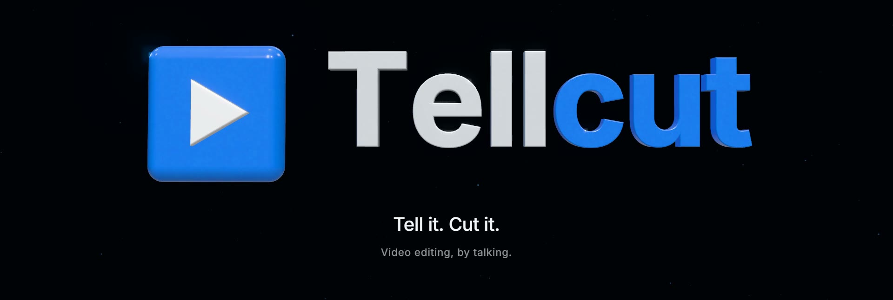
</p>

<p align="center"><strong>Video editing, by talking.</strong></p>

<p align="center">Drop in your footage and say what you want. An agent watches every clip,<br>writes the storyboard and cuts a first draft, all on your own computer.</p>

<p align="center">
  <strong>English</strong> &nbsp;·&nbsp; <a href="README.zh-TW.md">繁體中文</a>
</p>

<p align="center">
  <a href="#watch">Watch</a> &nbsp;·&nbsp;
  <a href="#three-ways-to-edit">Three ways to edit</a> &nbsp;·&nbsp;
  <a href="#what-the-agent-does">What the agent does</a> &nbsp;·&nbsp;
  <a href="#made-with-tellcut">Made with Tellcut</a> &nbsp;·&nbsp;
  <a href="#presets">Presets</a> &nbsp;·&nbsp;
  <a href="#get-started">Get started</a> &nbsp;·&nbsp;
  <a href="#api-keys-optional">API keys</a> &nbsp;·&nbsp;
  <a href="INSTALL.md">Install guide</a>
</p>

<p align="center">
  
  
  
  
  <a href="LICENSE"></a>
</p>

---

## Watch

<div align="center">
  <video src="https://github.com/user-attachments/assets/a82121b7-2dc8-4330-a473-0e79a1230809" width="100%" controls></video>
</div>

> **"Rome, by talking."** A 16-minute vlog becomes a 60-second, magazine-style Instagram reel. Import the footage, pick the Travel Highlights preset, say what you want in one sentence. The agent watches everything and cuts a first draft in one reply. Then fix things by hand on the timeline, or select a page and ask. Recorded in Tellcut, sped up where the agent works. ([credits](docs/readme/CREDITS.md))

---

## Your phone is full of clips nobody edits

<p align="center">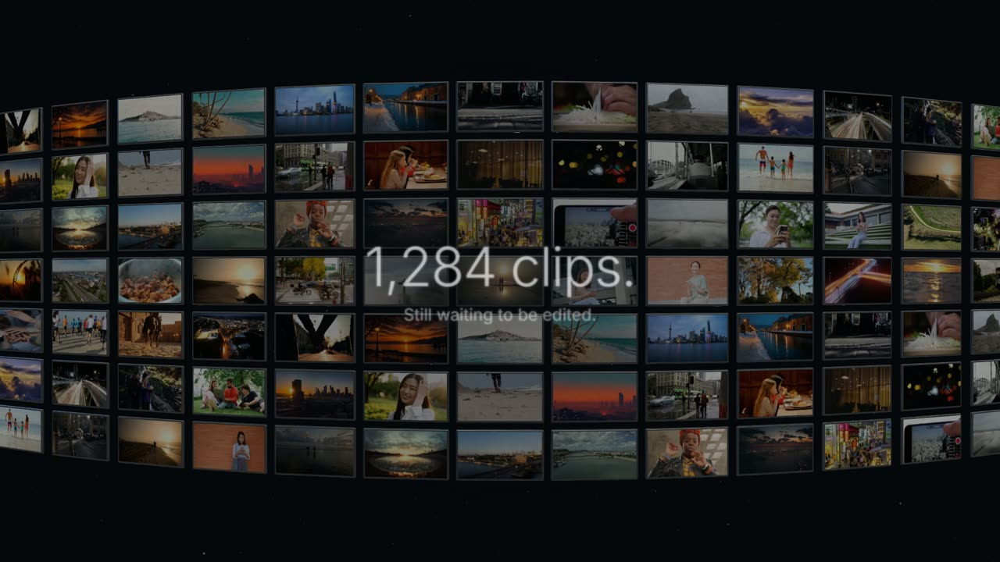</p>

The trip, the birthday, the podcast you recorded last month: the footage is fine. What stops it from becoming a video is the editing: scrubbing through hours of clips, choosing shots, cutting, captioning, finding music.

Tellcut hands that work to an agent and leaves the decisions with you. You describe the film. The agent makes a first cut you can watch. Then you change whatever you like, by hand or by asking.

---

## Three ways to edit

You can switch between these at any time. Nothing the agent does overwrites what you changed yourself.

<table>
  <tr>
    <td width="38%" valign="top">
      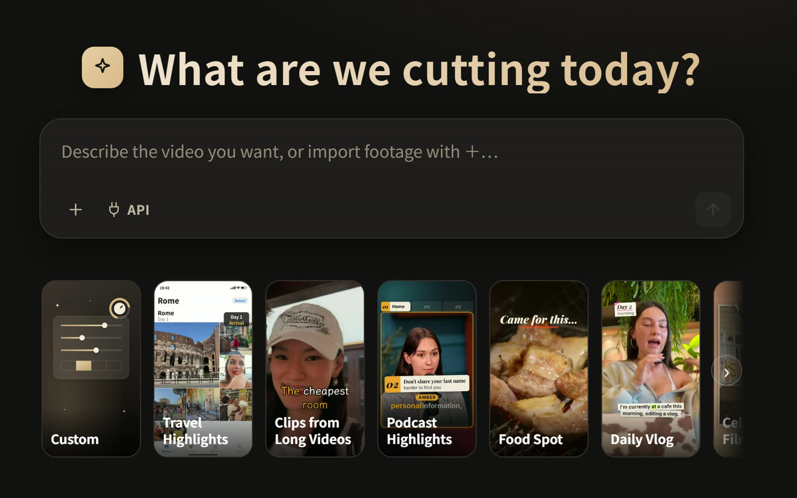
    </td>
    <td valign="top">
      <h3>1. Say it</h3>
      Import your footage and say what you want. The agent chooses the angle, the shots, the captions, the effects and the music, and cuts a first draft you can watch straight away.
      <br><br>
      Not sure what to ask for? Pick a <a href="#presets">preset</a> under the prompt box and it brings in a direction for that kind of film.
    </td>
  </tr>
</table>

<p align="center">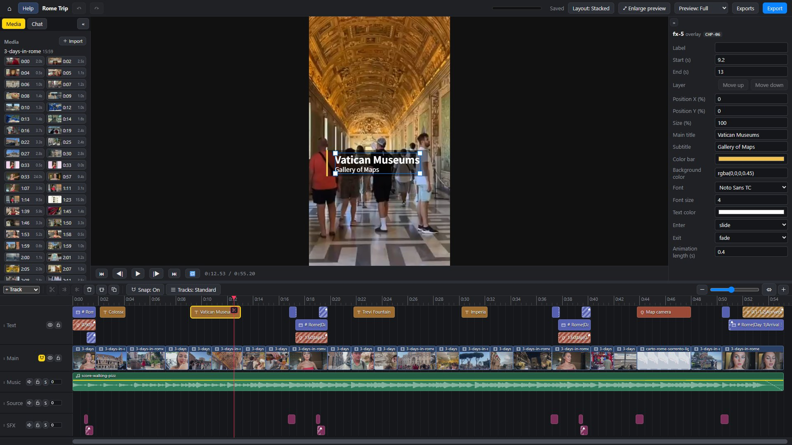</p>

**2. Fix it on the timeline.** It works like any editor: split clips, swap in another shot from the media panel, change the volume, edit a caption. Every change can be undone.

**3. Ask for changes.** Type in the chat, or select part of the timeline, right-click and choose **Ask Agent…** to describe what that part needs. The agent shows you a preview first. Nothing changes until you press **Accept**.

---

## What the agent does

<table>
  <tr>
    <td width="50%" valign="top">
      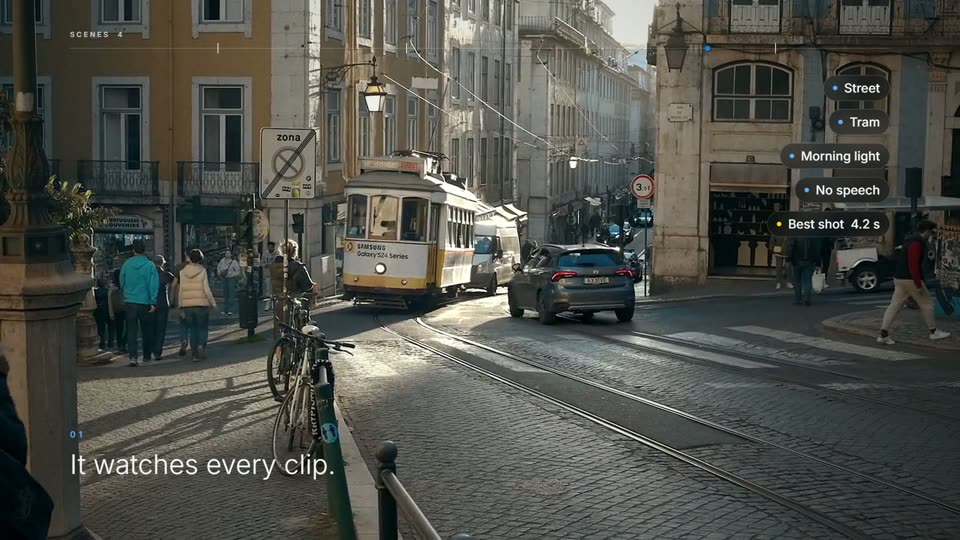<br>
      <strong>It watches every clip.</strong><br>
      It splits your footage into scenes, makes contact sheets, transcribes the speech, and finds the subtitles and watermarks burned into the source.
    </td>
    <td width="50%" valign="top">
      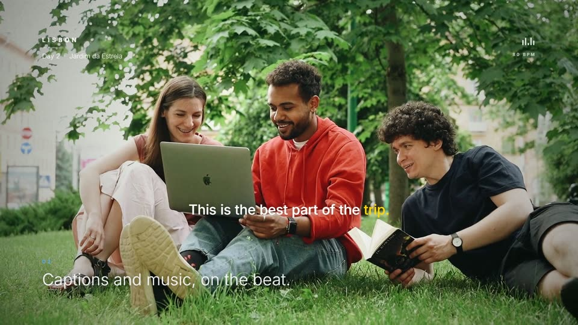<br>
      <strong>Captions and music, on the beat.</strong><br>
      It has more than 130 ready-made effects and sounds, and composes a score to fit the length. It can also add voice-over in the film's language, with the captions aligned to it. When nothing in the library fits, it writes a new effect for that film.
    </td>
  </tr>
  <tr>
    <td valign="top">
      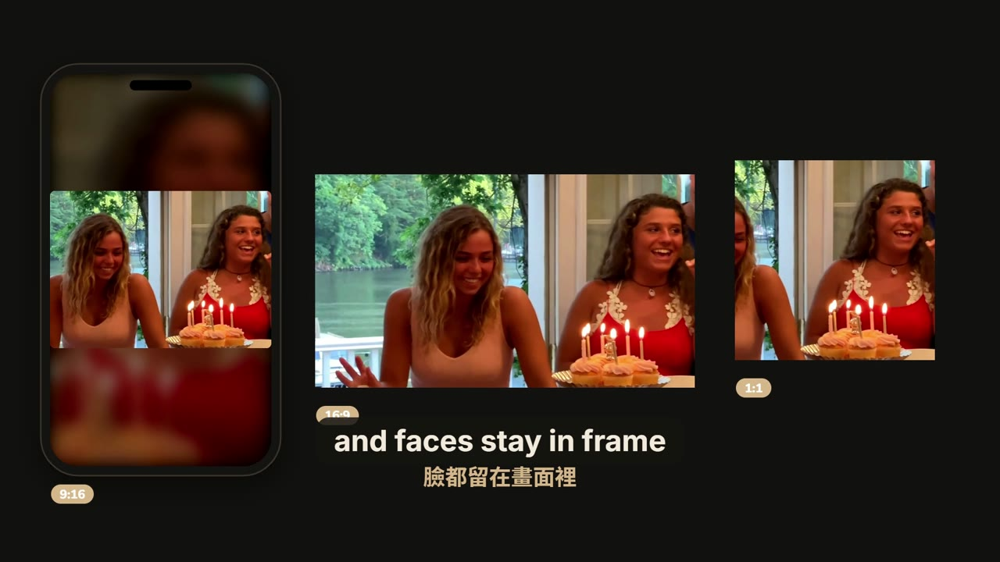<br>
      <strong>Vertical. Landscape. Square.</strong><br>
      It exports MP4 in 9:16, 16:9, 1:1 or 4:5, and keeps faces in frame when it reframes footage for vertical.
    </td>
    <td valign="top">
      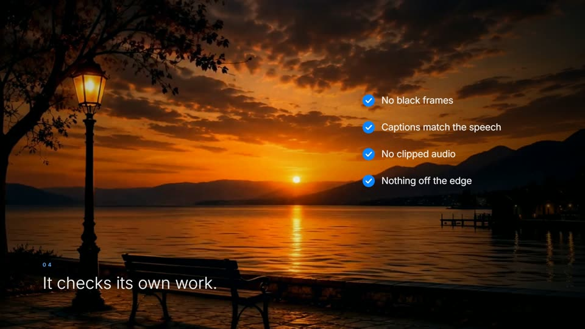<br>
      <strong>It checks its own work.</strong><br>
      Before you see the result, it checks for black frames, captions that drift from the speech, text running off the edge, clipped audio, and the source's own text showing through. It fixes what it finds first.
    </td>
  </tr>
</table>

It first works out what kind of film this is (food, travel, a lesson, an interview…) and writes the storyboard that kind of film needs before it cuts anything.

---

## Made with Tellcut

Each of these is a vertical short that Tellcut cut from a CC BY video on YouTube. Click one to see the original, its creator and what was changed.

<table>
  <tr>
    <td align="center" width="33%">
      <a href="guides/presets/travel/CREDITS.md">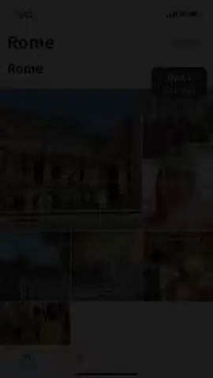</a><br>
      <strong>Travel Highlights</strong><br>
      <sub>55 s · three days in Rome · footage by Jackie Vlogs</sub>
    </td>
    <td align="center" width="33%">
      <a href="guides/presets/clips/CREDITS.md"></a><br>
      <strong>Clips from Long Videos</strong><br>
      <sub>37 s · one moment of a Marrakesh vlog · footage by Helen</sub>
    </td>
    <td align="center" width="33%">
      <a href="guides/presets/podcast/CREDITS.md">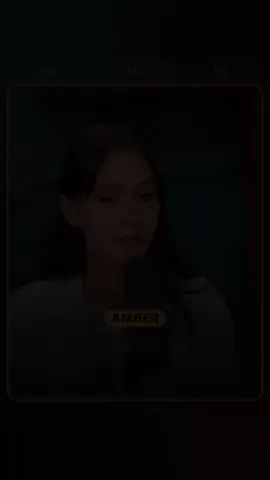</a><br>
      <strong>Podcast Highlights</strong><br>
      <sub>58 s · two speakers · footage by Lila Rose</sub>
    </td>
  </tr>
  <tr>
    <td align="center">
      <a href="guides/presets/food/CREDITS.md"></a><br>
      <strong>Food Spot</strong><br>
      <sub>58 s · Seoul BBQ and a bakery · footage by 千千進食中</sub>
    </td>
    <td align="center">
      <a href="guides/presets/vlog/CREDITS.md">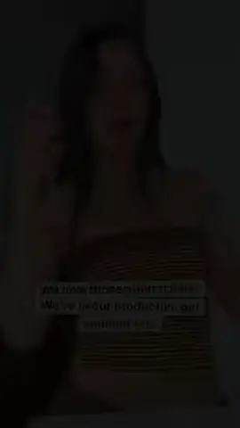</a><br>
      <strong>Daily Vlog</strong><br>
      <sub>66 s · three days, one to-do list · footage by Michaela Bento</sub>
    </td>
    <td align="center">
      <a href="guides/presets/celebration/CREDITS.md">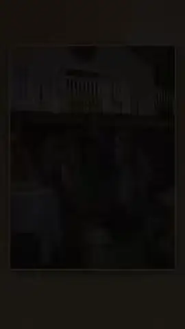</a><br>
      <strong>Celebration Film</strong><br>
      <sub>88 s · a surprise sweet sixteen · footage by It's The Donnellys</sub>
    </td>
  </tr>
</table>

> The source videos are published under [CC BY 3.0](https://creativecommons.org/licenses/by/3.0/). The captions, titles, cards and music are Tellcut's own.

---

## Presets

A preset is a starting direction for one kind of film. Click its card under the prompt box to read what it does, then press **Confirm**. You can also skip presets and just describe what you want.

| Preset | Best for |
|---|---|
| **Custom** | You set the ratio, length, framing and so on; the agent decides the rest |
| **Travel Highlights** | Scattered clips from a trip, cut into a vertical short for IG or Shorts |
| **Clips from Long Videos** | The best moment of a finished long video, with a hook if it should send people to the full video |
| **Podcast Highlights** | The best exchange from a podcast or interview, with who's speaking clearly marked and word-by-word captions |
| **Food Spot** | A restaurant or a food trip, cut into a short that makes people hungry |
| **Daily Vlog** | A day or a stretch of daily life, with rhythm and a beginning, middle and end |
| **Celebration Film** | Wedding, birthday, graduation or farewell photos and clips, cut into a film to play on the day |
| **Brand Film** | A brand film with 3D and real footage from just a logo and a paragraph about the company |
| **Animated Explainer** | One idea explained with diagrams and text, with or without footage of your own |
| **Auto** | Not sure? The agent decides |

---

## Get started

**You need**

- A **Windows** PC (only Windows is supported for now)
- **Node.js 24** and **Google Chrome**
- **Claude Code**, signed in. The editing agent is Claude Code, running on your own Claude account

**Then**

```powershell
npm run setup     # downloads the tools and models Tellcut needs (10–20 minutes)
npm run server    # then open http://127.0.0.1:5174/editor/ in your browser
```

Import footage in the chat on the right of the home page and tell the agent what you'd like to make. The full walkthrough, with troubleshooting, is in **[INSTALL.md](INSTALL.md)**. If something isn't working, `npm run doctor` lists what's missing and how to fix it.

The interface comes in English, 中文 and 日本語; switch with **中 / EN / 日** at the top right of the home page. Button labels in the editor are always English; tooltips and help follow your language.

> Your footage and your films stay on your computer. When you chat with the agent, your messages and the frames it needs to look at are sent to Anthropic.

---

## API keys (optional)

Everything works without any keys. A few of the outside sources the agent can draw on need a free key of your own; without it, that source just isn't available and everything else works as before.

| Source | What it gives | Where to get a free key |
|---|---|---|
| **Pixabay** | Stock video and photos | Sign up at Pixabay; your key is then shown on <https://pixabay.com/api/docs/> |
| **Freesound** | Sound effects | Sign in to Freesound and apply at <https://freesound.org/apiv2/apply>; use the "Client secret/Api key" it gives you |
| **CARTO** | Street-map basemaps for map scenes | Request one with your email at <https://carto.com/basemaps> (no account needed; non-commercial use only) |

Put the keys in a file called `sources.local.json` in the `tellcut` folder. Git ignores it, so it's never committed:

```json
{
  "contact": "you@example.com",
  "keys": {
    "pixabay": "your Pixabay key",
    "freesound": "your Freesound key",
    "carto": "your CARTO key"
  }
}
```

Or set environment variables instead, which win over the file: `PIXABAY_API_KEY`, `FREESOUND_API_KEY`, `CARTO_API_KEY`.

- **`contact`** (optional) is an email address or a web address that Tellcut sends in the User-Agent header of every download, so the sources know who is asking. Wikimedia Commons gives callers who say who they are much higher limits. The environment variable `TELLCUT_CONTACT` does the same.
- **Switching sources on or off**: the defaults are in `sources.json`. To change one, add it to `sources.local.json`, for example `"sources": { "steam": { "enabled": true } }`. BBC Sound Effects, Incompetech and Steam (unofficial, or personal use only) start switched off.
- **Check your setup** with `npm run sources`: it lists each source, whether it's on, whether it has its key and whether it answers. `npm run sources -- --live` also tries a real search and download from each. `npm run doctor` shows the same list.
- **In the chat**, the **API** button next to **＋** opens the list of sources. Tick the ones the agent may use in that conversation. A source that's missing its key is greyed out, with the reason.

---

## Try saying

**With footage**

> "These are from our three days in Rome. Make a 60-second vertical short for IG with an opening that makes people keep watching."

> "Pick the best stretch of this podcast episode and make a one-minute Short. Make it clear who's talking."

> "Turn these wedding photos and clips into a three-minute film to play at the reception."

**With no footage at all**

> "Make a 45-second animated explainer on why cats purr, with voice-over."

**After the first cut**

> Select a stretch of the timeline, right-click **Ask Agent…**, and type: "Too much text here. Keep only the key point."

---

## Usage and cost

Tellcut is free. The agent runs on your own Claude login, so what it uses depends on how you sign in:

- **A subscription (Pro / Max):** nothing extra is charged; the work counts toward your plan's usage limits.
- **An API key:** you pay per token at Claude API prices.

Under every reply you'll see how many tokens it used; the conversation total also shows roughly what that would cost at Claude API prices.

| For example (made in the page chat) | Tokens | At Claude API prices |
|---|---|---|
| A 1-minute travel short | about 2.5–5.5 million | about US$2–3 |

## Limitations

- Windows only.
- The agent can't hear. You have to judge the balance of music and voices, and whether the voice-over sounds natural, by ear.
- Local only: there's no cloud version, and two people can't edit the same project at once.

---

## Documentation

- [docs/reference.md](docs/reference.md): every command, the project folder format and the code architecture.
- [CLAUDE.md](CLAUDE.md): what to know when developing Tellcut with Claude Code.

<details>
<summary><strong>How the code is laid out</strong></summary>

```text
tellcut/
├── apps/
│   ├── player/        the one renderer: editor preview, export, checks and golden images all run it
│   ├── editor/        the timeline editor in the browser
│   └── server/        the local server and the page chat (one headless Claude Code per message)
├── packages/
│   ├── engine/        the project.json schema, compositor, edit commands and mix plan
│   ├── plugin-common/ shared blocks (captions, titles, effects, 3D…) and their golden images
│   ├── plugins/       the one plugin list every part shares
│   ├── media-node/    ffmpeg, analysis, transcription, faces, voice-over, score, export, outside sources
│   └── protocol/      shared types and gallery codes
├── tools/
│   ├── cut/           the Cut API: cut.ts rebuilds the timeline from the footage; recipes
│   ├── check/         the checks before export
│   └── setup/         npm run setup / doctor
└── guides/            what the agent reads: workflow, quality bar, genres, presets
```

</details>

## Licence

The code is released under the [MIT licence](LICENSE). The MIT licence covers the code only:

- The media in `docs/readme/` and the preset samples in `guides/presets/*/` (`poster.jpg`, `preview.webm`) are under the terms given in the `CREDITS.md` next to them: adaptations of CC BY 3.0 videos, and footage under the Pixabay Content License. Credits for the pictures and the film on this page are in [docs/readme/CREDITS.md](docs/readme/CREDITS.md).
- Third-party code keeps its own licence: the vertex shader in `packages/plugin-common/src/shader-vertex.ts` comes from Paper Shaders (Apache-2.0, see [LICENSE.paper-shaders](packages/plugin-common/LICENSE.paper-shaders) and [NOTICE.paper-shaders](packages/plugin-common/NOTICE.paper-shaders)).
- The outside tools and models downloaded during setup (ffmpeg, uv, Python, the Whisper speech model, the MediaPipe face model, fonts) each have their own licences.

Only import footage you have the right to use. Tellcut will download a link you give it (with yt-dlp), but it doesn't check who owns the video.
