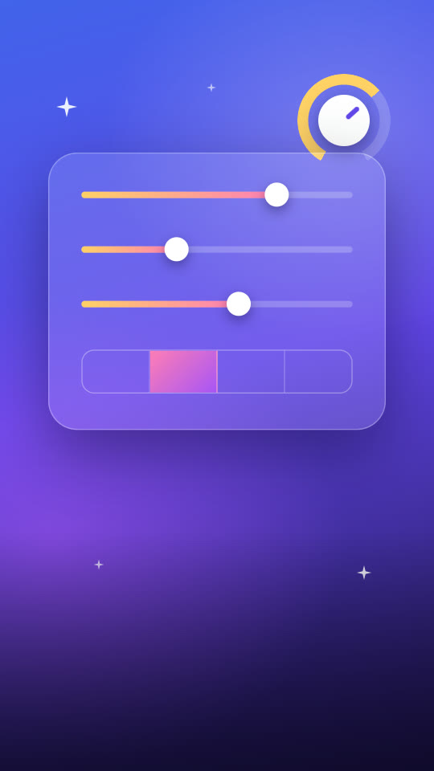
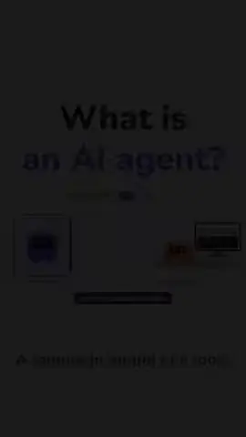

<p align="center">
  
</p>

<p align="center"><strong>用說的剪片。</strong></p>

<p align="center">把素材丟進來，說一句想要什麼樣的片。Agent 會看完每一段素材、寫好分鏡、剪出初版，<br>全部在你自己的電腦上跑。<br>喜歡的特效和風格可以留下來，下一支從那裡開始。</p>

<p align="center">
  <a href="README.md">English</a> &nbsp;·&nbsp; <strong>繁體中文</strong>
</p>

<p align="center">
  <a href="#看片">看片</a> &nbsp;·&nbsp;
  <a href="#三種剪法">三種剪法</a> &nbsp;·&nbsp;
  <a href="#agent-會做什麼">Agent 會做什麼</a> &nbsp;·&nbsp;
  <a href="#每剪一支下一支更快">留下好用的</a> &nbsp;·&nbsp;
  <a href="#片型">片型和範例片</a> &nbsp;·&nbsp;
  <a href="#開始用">開始用</a> &nbsp;·&nbsp;
  <a href="#外部素材來源">外部素材來源</a> &nbsp;·&nbsp;
  <a href="INSTALL.md">安裝說明（英文）</a>
</p>

<p align="center">
  
  
  
  
  <a href="LICENSE"></a>
</p>

---

## 看片

<div align="center">
  <video src="https://github.com/user-attachments/assets/44866a15-c389-4220-bc70-4d72278bbb78" width="100%" controls></video>
</div>

> **「Tellcut in 80 Seconds」** 十九分鐘的馬拉喀什素材加一句話，變成一支短片：Agent 先看完每段素材、寫好分鏡才開剪。之後在時間軸上自己改，或選一段請 Agent 改，套用前先看預覽。它為這支片寫的特效可以留下，這支片的做法可以存成你自己的片型，下一趟旅行就從那裡開始。全程在 Tellcut 裡錄製，Agent 工作的部分有加速。（[出處](docs/readme/CREDITS.md)）

---

## 手機裡的影片，大多沒有人剪

<p align="center"></p>

出去玩、慶生、上個月錄的 Podcast，素材都拍好了，卡住的是剪：一段一段看、挑鏡頭、剪接、上字幕、找配樂。

Tellcut 把這些工作交給 Agent，決定權留在你手上。你說想要什麼片，Agent 先剪出一支能看的初版，之後要怎麼改都可以，自己動手或開口請它改都行。

---

## 三種剪法

三種隨時可以切換。Agent 改的東西不會蓋掉你自己改過的地方。

<table>
  <tr>
    <td width="38%" valign="top">
      
    </td>
    <td valign="top">
      <h3>1. 用說的</h3>
      匯入素材，說你想要什麼。題目、鏡頭、字幕、特效、配樂都由 Agent 決定，剪出一支可以直接看的初版。
      <br><br>
      不知道怎麼說？對話框下面選一個<a href="#片型">片型</a>，就會帶進那一類片的做法。
    </td>
  </tr>
</table>

<p align="center"></p>

**2. 在時間軸上自己改。** 跟一般剪輯軟體一樣：切開片段、從素材庫換鏡頭（或用 **Import** 從電腦加更多素材）、調音量、改字。改錯了可以復原。

**3. 用對話再改。** 在對話框直接說，或在時間軸上選一段、按右鍵「**Ask Agent…**」，說那一段要怎麼改。Agent 會先給你預覽，按「**Accept**」才算數。

---

## Agent 會做什麼

<table>
  <tr>
    <td width="50%" valign="top">
      <br>
      <strong>每一段素材都看過。</strong><br>
      把影片切成場景、做縮圖總覽、把講話轉成逐字稿，也會找出原片自己燒進去的字幕和浮水印。
    </td>
    <td width="50%" valign="top">
      <br>
      <strong>字幕和配樂，都對在拍子上。</strong><br>
      內建 130 多種現成的畫面效果和音效，配樂依片長自動作曲；也能照影片的語言加旁白，字幕自動對齊。現成的不夠用時，Agent 會替這支片寫專屬的效果，你還可以<a href="#每剪一支下一支更快">留下來</a>給下一支用。
    </td>
  </tr>
  <tr>
    <td valign="top">
      <br>
      <strong>直式、橫式、方形。</strong><br>
      輸出 9:16、16:9、1:1、4:5 的 MP4；橫式素材改成直式時，會跟著人臉取景。
    </td>
    <td valign="top">
      <br>
      <strong>交給你之前，先自己檢查。</strong><br>
      黑畫面、字幕對不上講話、字跑出畫面、爆音、原片的字露出來，Agent 會先找出來自己修。
    </td>
  </tr>
</table>

動手之前，它會先判斷這是哪一類影片（美食、旅遊、教學、訪談…），照那一類該有的東西寫分鏡，再開始剪。

## 每剪一支，下一支更快

<p align="center"><strong>喜歡的留下來，下一支從這裡開始。</strong></p>

大部分剪輯軟體一關掉專案，就什麼都忘了。Tellcut 會記得你喜歡的。

<table>
  <tr>
    <td width="50%" valign="top">
      <h3>★ 留下一個特效</h3>
      Agent 替你的咖啡店影片寫了黑板粉筆標題、一張印出菜單的收據、一條畫出路線的地圖。按旁邊的 <strong>☆</strong>，它就進了「<strong>我的積木</strong>」。
      <br><br>
      之後每個專案的媒體面板都有它，Agent 也會先拿它來用，不再重寫。想讓它換什麼字、什麼顏色都能用？勾「<strong>請 Agent 整理成通用版</strong>」，原本寫死的地方會變成可以調的設定。
    </td>
    <td width="50%" valign="top">
      <h3>⟳ 留下你的風格</h3>
      剪出喜歡的節奏了？按「<strong>Save as preset</strong>」。Agent 會把這支片的做法一條條寫成白話：「前 2 秒放最好看的畫面」「字幕放中間偏下」「不放價格卡」。劃掉不要的、加上自己的，它就變成首頁上的一張片型卡，字型、顏色、配樂、特效一起帶走。
      <br><br>
      下次出去玩，點一下，初版就已經是你的味道。
    </td>
  </tr>
</table>

- **你看到的，就是 Agent 拿到的全部。** 片型的條列就是它全部的指示，刪掉一條，那條指示就不見了。
- **舊片不會偷偷變樣。** 積木是複製一份進每個用到它的專案。之後改進了，其他專案會出現「**Update**」，按了才換。
- **不用先做一支片。** 在「**自定義**」表單選好選項，按「**存成我的片型**」；或按首頁片型最後一張「**新片型**」，自己一條一條寫。
- 在積木圖鑑的「**我的積木**」分類裡瀏覽、改名、試看，或請 Agent 幫你改。

---

## 片型

片型是某一類片的起手方向。點對話框下面的縮圖會看到說明，按「**確認**」就帶進來。不選也可以，直接用說的。

下面的動圖是用各個片型做的範例片，點圖看出處和改了什麼。實拍的範例改編自 YouTube 上以 [CC BY 3.0](https://creativecommons.org/licenses/by/3.0/) 釋出的影片，字幕、標題、卡片、配樂都是 Tellcut 自己加的；品牌形象片和圖解故事的範例沒有用任何素材，畫面全是 Agent 畫的。

<table>
  <tr>
    <td align="center" valign="top" width="33%">
      <br>
      <strong>自定義</strong><br>
      自己決定比例、長度、構圖這些，其他交給 Agent；選好的還能存成自己的片型
    </td>
    <td align="center" valign="top" width="33%">
      <a href="guides/presets/travel/CREDITS.md"></a><br>
      <strong>旅行精華</strong><br>
      旅途中拍的零散片段，剪成適合放 IG、Shorts 的直式短片<br>
      <sub>範例：55 秒・羅馬三日・素材 Jackie Vlogs</sub>
    </td>
    <td align="center" valign="top" width="33%">
      <a href="guides/presets/clips/CREDITS.md"></a><br>
      <strong>精華切片</strong><br>
      從一支完成的長片挑出最精彩的一段；要導流回原片就加開頭鉤子<br>
      <sub>範例：37 秒・馬拉喀什 vlog 的一段・素材 Helen</sub>
    </td>
  </tr>
  <tr>
    <td align="center" valign="top">
      <a href="guides/presets/podcast/CREDITS.md"></a><br>
      <strong>Podcast 精華</strong><br>
      Podcast 或訪談裡最好聽的一段，清楚標出誰在說話，配逐字字幕<br>
      <sub>範例：58 秒・兩人對談・素材 Lila Rose</sub>
    </td>
    <td align="center" valign="top">
      <a href="guides/presets/food/CREDITS.md"></a><br>
      <strong>美食探店</strong><br>
      一家店或一趟吃喝，剪成讓人看了就餓的短片<br>
      <sub>範例：58 秒・首爾炭烤＋麵包店・素材 千千進食中</sub>
    </td>
    <td align="center" valign="top">
      <a href="guides/presets/vlog/CREDITS.md"></a><br>
      <strong>生活 Vlog</strong><br>
      一天或一段日常的零碎片段，剪成有節奏、有起承轉合的 vlog<br>
      <sub>範例：66 秒・三天的待辦清單・素材 Michaela Bento</sub>
    </td>
  </tr>
  <tr>
    <td align="center" valign="top">
      <a href="guides/presets/celebration/CREDITS.md"></a><br>
      <strong>紀念影片</strong><br>
      婚禮、生日、畢業或送別的照片和影片，剪成能在現場播的紀念影片<br>
      <sub>範例：88 秒・十六歲生日驚喜・素材 It's The Donnellys</sub>
    </td>
    <td align="center" valign="top">
      <a href="guides/presets/brand/CREDITS.md"></a><br>
      <strong>品牌形象片</strong><br>
      從商標、一段公司介紹和官網，做出一看就是這家公司的品牌形象片；有自己的影片或照片更好<br>
      <sub>範例：57 秒橫式・Tellcut 自己的品牌片・全從 logo 畫出來</sub>
    </td>
    <td align="center" valign="top">
      <a href="guides/presets/explainer/CREDITS.md"></a><br>
      <strong>圖解故事</strong><br>
      用圖解、圖表、測驗或迷思破解把一件事講清楚，可以完全不用素材<br>
      <sub>範例：2 分 9 秒橫式・什麼是 AI Agent？・沒有素材</sub>
    </td>
  </tr>
</table>

**你自己的片型**排在這些後面，標著「**我的**」：從一支喜歡的片存（編輯器聊天分頁的「**Save as preset**」），或從「**自定義**」表單存。見[每剪一支，下一支更快](#每剪一支下一支更快)。

---

## 開始用

**需要**

- **Windows 10 或 11**（64 位元，目前只支援 Windows）
- **Claude 帳號**：Pro、Max、Team、Enterprise 方案或 Claude API 帳號都可以。剪片的 Agent 是 Claude Code，用的是你自己的帳號（見[用量與費用](#用量與費用)）
- 約 **4 GB** 硬碟空間和網路（第一次安裝要下載約 2 GB）

Node.js、Google Chrome、Python、ffmpeg 這些，下面兩種裝法都會幫你處理。

### 方法一：請 Claude Code 幫你裝（推薦）

Claude Code 是在終端機裡用的 Claude，能直接在你的電腦上下載、安裝、跑指令，遇到錯誤也會自己修。網頁版的 claude.ai 碰不到你的電腦，只能教你步驟，沒辦法代裝。

1. **打開 PowerShell**：按開始鍵，輸入 `PowerShell`，按 Enter。不用以系統管理員身分執行。
2. **安裝 Claude Code**：貼上這一行，按 Enter：

   ```powershell
   irm https://claude.ai/install.ps1 | iex
   ```

   裝完輸入 `claude --version`，出現版本號就是裝好了；說找不到 `claude` 的話，關掉 PowerShell 再開一個。也可以改用 `winget install Anthropic.ClaudeCode`（[官方安裝說明](https://code.claude.com/docs/en/setup)）。
3. **登入**：輸入 `claude`，按 Enter，照畫面在瀏覽器登入你的 Claude 帳號。
4. **選 Opus 5.5**：在 Claude Code 裡輸入 `/model opus`，按 Enter。我們建議用 Opus 5.5，Tellcut 的安裝和剪片都是用它測的。Opus 5.5 要 Claude Code 2.1.280 以上，版本太舊就先在 PowerShell 跑 `claude update`。
5. **把這段話貼給它**：

   ```text
   請幫我安裝 Tellcut：https://github.com/samuel325365/Tellcut
   照 repo 裡的 INSTALL.md 做。如果缺 Node.js 24 以上或 Google Chrome，先用 winget 幫我裝好。
   把 repo 下載到我的使用者資料夾裡的 Tellcut，跑 npm run setup，最後用 npm run doctor 確認每一項都打勾。
   遇到錯誤就修好再繼續。全部好了之後，告訴我以後要怎麼打開 Tellcut。
   ```

   Claude Code 每做一件事會先問你可不可以，看過再按允許。全部大約 15～30 分鐘，大多花在下載。
6. **打開 Tellcut**：之後每次要用，在 PowerShell 裡跑：

   ```powershell
   cd ~\Tellcut
   npm run server
   ```

   再用瀏覽器打開 <http://127.0.0.1:5174/editor/>。用的時候 PowerShell 視窗要開著，關掉 Tellcut 就停了。

**用 Codex 或其他 AI 程式助手也能裝**：把第 5 步那段話貼給它就行。不過 Tellcut 裡剪片的 Agent 一定是 Claude Code，第 2～3 步還是要做。

### 方法二：自己裝

1. 裝好 [Node.js](https://nodejs.org/) 24 以上（選 LTS）、[Google Chrome](https://www.google.com/chrome/) 和 [Claude Code](https://code.claude.com/docs/en/setup)，在終端機跑一次 `claude` 登入。
2. 下載 Tellcut：有裝 [Git](https://git-scm.com/downloads/win) 就跑 `git clone https://github.com/samuel325365/Tellcut.git`；沒有的話，在 GitHub 頁面按綠色的「**Code**」→「**Download ZIP**」，解壓縮。用 git 下載，之後更新比較方便。
3. 在 Tellcut 資料夾的空白處按右鍵 →「**在終端機中開啟**」，然後跑：

   ```powershell
   npm run setup     # 自動下載需要的工具和模型（約 10～20 分鐘）
   npm run server    # 再用瀏覽器打開 http://127.0.0.1:5174/editor/
   ```

完整步驟和疑難排解在 **[INSTALL.md](INSTALL.md)**（英文）。出問題時先跑 `npm run doctor`，它會列出哪裡沒裝好、怎麼修；也可以直接在 Claude Code 裡說「Tellcut 打不開，幫我看看」。

**更新**：用 git 下載的，在 Tellcut 資料夾跑 `git pull`，再跑一次 `npm run setup`。

### 用哪個模型

Tellcut 的 Agent 用 Claude Code 的**預設模型**。Pro、Max、Team、Enterprise 和 Claude API 帳號現在的預設都是 **Opus 5.5**，也就是我們建議的模型，不用另外設定。頁面裡的對話不會讀你 Claude Code 的個人設定，所以在終端機用 `/model` 換成別的模型，不會影響 Tellcut。

### 剪第一支片

在首頁右邊的對話框按 **＋** 匯入素材，跟 Agent 說你想做什麼樣的片；不知道怎麼說，可以參考[試試這樣說](#試試這樣說)，或選一個[片型](#片型)。

介面有中文、English、日本語三種，首頁右上角的「中 / EN / 日」可以切換；編輯器裡的按鈕字固定是英文，說明跟著語言走。

> 素材和成品都留在你的電腦裡；跟 Agent 對話時，你的訊息和它需要看的畫面會送到 Anthropic。

---

## 範例專案

Tellcut 自己的形象片附上整個專案，可以打開來播、來改：素材、和 Agent 的對話、版本紀錄，還有成品。它是用品牌片片型做的。

```powershell
npm run examples -- meet-tellcut     # 下載並加進你的專案（約 900 MB）
```

專案的 `CREDITS.md` 寫了素材出處，全部是創用 CC（CC BY 3.0）。

---

## 外部素材來源

除了你自己的素材，Agent 還能從網路上的素材庫和資料庫找圖、影片、音效、配樂和地圖。大部分不用申請就能用；少數要你自己申請一把免費的 key，沒填的話只是那個來源不能用，其他照常。

> 這裡說的 key 跟 Claude 無關。Agent 用的是你在 Claude Code 登入的帳號，不需要另外的 Claude API key。旁白（Microsoft Edge 的線上語音）、語音轉文字（在你電腦上跑的 Whisper）和配樂（依片長自動作曲）也都內建，不用任何 key。

Agent 下載的每個檔案，出處和授權都會記在專案裡，`npm run tellcut -- assets credits <專案>` 會把它們整理成專案資料夾裡的 `CREDITS.md`。**要公開發表或商用之前，請看一下授權欄**：寶可夢、動漫、遊戲、哈利波特這類的圖，版權屬於原公司。

**不用申請，裝好就能用**

| 來源 | 提供什麼 | 授權 |
|---|---|---|
| **Wikimedia Commons** | 照片、插圖、歷史圖片 | 每個檔案不同，多半是 CC BY、CC BY-SA 或公有領域 |
| **NASA Image and Video Library** | 太空、地球的照片和影片 | 一般沒有著作權；不能暗示 NASA 背書 |
| **地圖** | 臺灣通用電子地圖、國土測繪中心正射影像、EOX 衛星圖，做路線動畫和地圖場景 | 臺灣圖資用政府資料開放授權（可商用，要標出處）；EOX 衛星圖是 CC BY-NC-SA 4.0（不可商用） |
| **Countries** | 國旗，以及首都、人口、語言、貨幣這些國家資料 | 國旗是公有領域 |
| **TheMealDB**、**TheCocktailDB** | 料理和調酒的照片、食譜 | 用公開的測試 key，只限個人和開發用途 |
| **PokeAPI** | 寶可夢的圖和圖鑑資料 | © Nintendo／Creatures／GAME FREAK |
| **AniList** | 動畫、漫畫的角色圖和作品封面 | © 各作品權利人 |
| **AmiiboAPI** | amiibo 公仔的圖 | © Nintendo |
| **Game wikis** | 瑪利歐、薩爾達維基上的遊戲圖 | © 遊戲公司（維基以合理使用收錄） |
| **HP-API + PotterDB** | 哈利波特的角色、咒語資料和圖 | © Warner Bros. |

**要申請免費的 key**

| 來源 | 提供什麼 | 授權 | 去哪裡申請 |
|---|---|---|---|
| **Pixabay** | 實拍影片和照片 | Pixabay Content License（可商用，不用標出處） | 註冊 Pixabay 帳號後，key 就顯示在 <https://pixabay.com/api/docs/> |
| **Freesound** | 音效 | 每個音效不同：CC0、CC BY、CC BY-NC… | 登入 Freesound，到 <https://freesound.org/apiv2/apply> 申請；用它給的「Client secret/Api key」 |
| **CARTO** | 地圖場景用的街道底圖 | 限非商業用途 | 到 <https://carto.com/basemaps> 用 email 申請（不用帳號） |

**預設關閉，要自己打開**（非官方，或只限個人使用）

| 來源 | 提供什麼 | 授權 |
|---|---|---|
| **BBC Sound Effects** | 約 3 萬 3 千個 BBC 的專業音效 | RemArc：只限個人、教育、研究用途，不能再散布 |
| **Incompetech** | Kevin MacLeod 的配樂（從 archive.org 上的備份下載） | CC BY 4.0（可商用，要標作者） |
| **Steam** | 遊戲的商店封面、截圖和預告片（非官方 API） | © 遊戲開發商／發行商 |

### 填 key、開關來源

把 key 寫進 `tellcut` 資料夾裡的 `sources.local.json`。git 會忽略這個檔，不會被 commit：

```json
{
  "contact": "you@example.com",
  "keys": {
    "pixabay": "你的 Pixabay key",
    "freesound": "你的 Freesound key",
    "carto": "你的 CARTO key"
  }
}
```

也可以改設環境變數（優先於檔案）：`PIXABAY_API_KEY`、`FREESOUND_API_KEY`、`CARTO_API_KEY`。

- **`contact`**（選填）是一個 email 或網址，Tellcut 每次下載都會放在 User-Agent 標頭裡，讓來源知道是誰在要資料。Wikimedia Commons 給有表明身分的呼叫者高很多的額度。也可以改設環境變數 `TELLCUT_CONTACT`。
- **開關來源**：預設值在 `sources.json`。要改哪一個，就把它寫進 `sources.local.json`，例如 `"sources": { "steam": { "enabled": true } }`。BBC Sound Effects、Incompetech、Steam（非官方，或只限個人使用）預設是關的。
- **檢查設定**用 `npm run sources`：列出每個來源開了沒、有沒有 key、連不連得上。`npm run sources -- --live` 還會從每個來源真的搜尋、下載一次。`npm run doctor` 也會列出同一張表。
- **在對話框裡**，**＋** 旁邊的 **API** 按鈕會打開來源清單，勾選這串對話裡 Agent 可以用的來源。缺 key 的來源會變灰，並寫出原因。

---

## 試試這樣說

**有素材**

> 「這是我們去羅馬三天拍的，剪一支 60 秒的直式短片放 IG，開頭要讓人想看下去。」

> 「從這集 Podcast 挑出最好聽的一段，剪成一分鐘的 Shorts，誰在講話要標清楚。」

> 「把這些婚禮的照片和影片剪成三分鐘的紀念影片，要在婚宴上播。」

**完全沒有素材**

> 「做一支 45 秒的圖解短片，講為什麼貓會發出呼嚕聲，配旁白。」

**剪好之後**

> 在時間軸上選一段，右鍵「Ask Agent…」：「這段字太多了，只留重點。」

---

## 用量與費用

Tellcut 本身免費。Agent 用的是你自己的 Claude 登入，用量怎麼算看你怎麼登入：

- **訂閱方案（Pro／Max）**：不另外收費，只算進方案的用量額度。
- **API key**：照 Claude API 價格按 token 計費。

每則回覆下面會顯示它用了多少 token；整串對話的合計旁邊還會顯示，改走 Claude API 計價大約多少錢。

| 參考（在頁面對話裡做的） | token | 照 Claude API 價格 |
|---|---|---|
| 一支 1 分鐘左右的旅遊短片 | 約 250～550 萬 | 約 US$2～3 |

## 目前的限制

- 只支援 Windows。
- Agent 聽不到聲音：配樂和人聲的大小、旁白念得自不自然，要你自己聽。
- 只在本機用，沒有雲端版，也不能多人同時編輯同一個專案。

---

## 文件

- [docs/reference.md](docs/reference.md)：全部指令、專案資料夾格式、程式架構。
- [CLAUDE.md](CLAUDE.md)：在這個專案用 Claude Code 開發時要知道的事。

除了這份 README，其他文件都是英文。

<details>
<summary><strong>程式架構一覽</strong></summary>

```text
tellcut/
├── apps/
│   ├── player/        唯一的畫面實作：編輯器預覽、輸出、check、golden 圖都跑它
│   ├── editor/        瀏覽器裡的時間軸編輯器
│   └── server/        本機伺服器、頁面聊天（每則訊息起一個 headless Claude Code）
├── packages/
│   ├── engine/        project.json 的 schema、合成器、編輯指令、混音計畫
│   ├── plugin-common/ 共用積木（字幕、標題、特效、3D…）和它們的 golden 圖
│   ├── plugins/       各端共用的外掛清單
│   ├── media-node/    ffmpeg、素材分析、轉錄、人臉、旁白、配樂、輸出、外部素材來源
│   └── protocol/      共用型別、圖鑑代號
├── tools/
│   ├── cut/           Cut API：從素材重建時間軸的 cut.ts、配方
│   ├── check/         輸出前的檢查
│   └── setup/         npm run setup / doctor
└── guides/            給 Agent 看的做片流程、品質標準、影片類型、片型
```

</details>

## 授權

程式碼以 [MIT 授權](LICENSE) 釋出。MIT 只涵蓋程式碼：

- `docs/readme/` 裡的圖和影片，以及 `guides/presets/*/` 的片型範例（`poster.jpg`、`preview.webm`），依旁邊 `CREDITS.md` 寫的條件使用：改編自 CC BY 3.0 影片，以及 Pixabay Content License 的素材。這一頁的圖和影片出處見 [docs/readme/CREDITS.md](docs/readme/CREDITS.md)。
- 第三方程式碼維持原本的授權：`packages/plugin-common/src/shader-vertex.ts` 的頂點著色器來自 Paper Shaders（Apache-2.0，見 [LICENSE.paper-shaders](packages/plugin-common/LICENSE.paper-shaders) 和 [NOTICE.paper-shaders](packages/plugin-common/NOTICE.paper-shaders)）。
- 安裝時下載的外部工具和模型（ffmpeg、uv、Python、Whisper 語音辨識模型、MediaPipe 人臉模型、字型）各有自己的授權。

只匯入你有權使用的影片。給 Tellcut 一個網址，它就會（用 yt-dlp）下載，但不會幫你確認影片是誰的。
